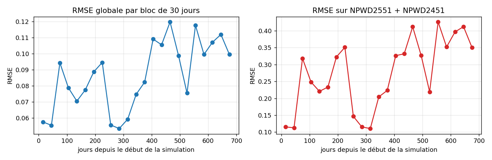
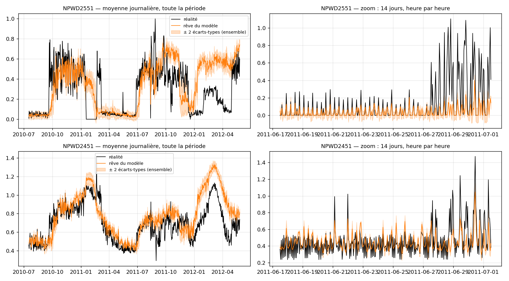

# Dream in Orbit - un world model de la consommation électrique d'un satellite

Un réseau de neurones (ensemble de GRU) qui apprend, sur de vraies données de télémétrie, comment un satellite
consomme de l'électricité selon son planning, puis **simule heure par heure la consommation de ses 33 circuits sur
une année entière**, à partir du seul planning et de ses 7 premiers jours réels.

Auteur : Mohsine ESSAT (ECE École d'Ingénieurs Paris, Bachelor's Degree Intelligence Artificial ) — Intelligence Lab.

## Contexte

Un satellite doit se chauffer pour que ses équipements ne gèlent pas, et ce chauffage consomme une grande partie de son
électricité. Pour planifier ses opérations (pointer un instrument, communiquer avec la Terre, traverser une éclipse), les
opérateurs doivent savoir à l'avance combien il va consommer. Les modèles physiques écrits à la main ne sont pas assez
précis : l'idée est d'apprendre ce comportement à partir de l'historique.

La solution s'appelle un **world model** : un simulateur appris à partir de données, au lieu d'être écrit avec des
équations. Il répond toujours à la même question :

> **état actuel + actions + contexte → état suivant**

Pour simuler une longue période, un world model classique prédit l'heure suivante, puis réutilise sa propre prédiction
pour prédire l'heure d'après, et ainsi de suite : c'est le « rêve ». Le problème est que chaque petite erreur s'ajoute à la
suivante et que le rêve dérive. C'est un sujet très actif de la recherche en IA (robotique, conduite autonome, simulation).

**Le défi.** À partir du seul planning du satellite (ce qu'il fait, où est le Soleil, quand arrivent les éclipses) et de ses
7 premiers jours réels, simuler heure par heure la consommation de ses 33 circuits électriques sur une année entière.
Tous les participants sont évalués sur le même jeu de test, caché (une période qui suit celles du kit), avec la RMSE
(écart quadratique moyen entre prédiction et réalité, sur toutes les heures et tous les circuits ; plus bas = mieux).
Repère donné par l'énoncé : une prédiction constante donne environ 0,11 à 0,13.

**Règles.** Données du kit uniquement (toute donnée extérieure est interdite) ; le modèle final doit être un réseau de
neurones ; `train.py` doit tout ré-entraîner depuis le kit ; `predict.py` doit respecter une interface imposée.

## Les données

Données réelles de télémétrie d'un satellite en opération, rendues publiques par une agence spatiale. Le kit contient
deux périodes consécutives (environ 3,8 ans au total) : `annee1` (du 22 août 2008 au 9 juillet 2010) et `annee2`
(du 10 juillet 2010 au 26 mai 2012). Chacune contient six fichiers, avec des temps en millisecondes UTC (`ut_ms`) :

| Fichier | Contenu | Rôle |
|---|---|---|
| `power.csv` | courant mesuré sur 33 circuits (`NPWDxxxx`), une mesure toutes les ~32 s (environ 1,8 million de lignes par période) | l'état à prédire |
| `dmop.csv` | commandes envoyées aux sous-systèmes | actions |
| `ftl.csv` | modes de pointage (vers la Terre, vers la planète, manœuvre...) et communications | actions |
| `saaf.csv` | angles du Soleil par rapport au satellite | contexte |
| `evtf.csv` | événements : éclipses, passages au plus près de la planète, contacts radio | contexte |
| `ltdata.csv` | tendances journalières : distances au Soleil et à la Terre, durée des éclipses | contexte |

Ce que l'exploration a montré (`src/inspect_power.py`) :
- Les 33 circuits n'ont pas du tout la même amplitude. Comme la RMSE est calculée en unités brutes, deux circuits
  (NPWD2551 et NPWD2451) dominent l'erreur ; plusieurs circuits sont quasi constants.
- Le comportement de certains circuits change d'une période à l'autre : par exemple, NPWD2531 a une consommation moyenne
  d'environ 0,12 en `annee1` et d'environ 0,01 en `annee2`. Valider sur une période jamais vue est donc indispensable
  (jamais de découpage aléatoire).
- Quelques trous de mesure existent (jusqu'à 23 heures) : l'évaluation ne note que les heures où la vérité existe.

## Résultat

Protocole officiel (`make_validation.py` + `evaluate.py`), entraînement sur `annee1`, test sur `annee2` (période jamais vue) :

| Modèle | RMSE |
|---|---|
| Prédiction constante (moyenne des 7 jours d'init) | 0,1116 |
| Gradient boosting par circuit, sur le contexte | 0,0984 |
| GRU seul | 0,0907 |
| **Ensemble de 3 GRU** (`weights/gru_val.pth`) | **0,0883** |

Le modèle final (`weights/gru_ensemble.pth`) est un ensemble de 5 GRU entraîné sur `annee1` + `annee2`.
Son score sur `annee2` n'a pas de valeur de performance (`annee2` a servi à l'entraîner) : la référence honnête est 0,0883.

## Structure du dépôt

```
predict.py            simulation : python3 predict.py --test_dir DOSSIER --out predictions.csv
train.py              entraînement de l'ensemble, en une commande
src/features.py       features horaires construites uniquement à partir des 5 fichiers de contexte
src/gru_model.py      données, modèle GRU, entraînement, inférence (utilisé par train.py et predict.py)
src/baseline.py       baselines : constante et gradient boosting
src/ablation.py       ablations du gradient boosting (familles de features, mémoire)
src/ablation_gru.py   ablations du GRU, validées dans les deux sens (annee1->annee2 et annee2->annee1)
src/gru_experiment.py première expérience GRU (annee1 -> annee2)
src/analyse.py        courbe de dérive, « rêve contre réalité » avec incertitude, erreurs par circuit
src/inspect_power.py  résumé des fichiers power.csv
reports/              résultats et figures
weights/              poids entraînés
kit_etudiants/        kit fourni (les gros CSV ne sont pas versionnés)
```

## Installation

Testé avec Python 3.12 et PyTorch 2.8 (CPU suffisant).

```bash
python3 -m venv .venv
source .venv/bin/activate
pip install -r requirements.txt
```

Placer le kit dans `kit_etudiants/annee1/` et `kit_etudiants/annee2/` (chacun avec `power.csv`, `dmop.csv`, `evtf.csv`,
`ftl.csv`, `saaf.csv`, `ltdata.csv`).

## Utilisation

**Entraîner** (environ 6 minutes sur un MacBook Air, CPU ; graines fixées de 0 à 4) :

```bash
python3 train.py                      # annee1 + annee2 -> weights/gru_ensemble.pth
```

**Simuler** :

```bash
python3 predict.py --test_dir DOSSIER --out predictions.csv
```

`DOSSIER` contient `dmop.csv`, `evtf.csv`, `ftl.csv`, `saaf.csv`, `ltdata.csv`, `power_init.csv` et `heures_a_predire.csv`.
Sortie : `ut_ms` + 33 colonnes `NPWDxxxx`, une ligne par heure. L'option `--out_std` écrit l'incertitude (écart-type de l'ensemble).

**Reproduire la validation** (score 0,0883) :

```bash
python3 train.py --train kit_etudiants/annee1 --out weights/gru_val.pth --seeds 3
python3 kit_etudiants/make_validation.py --annee kit_etudiants/annee2 --out validation
python3 predict.py --test_dir validation/test --weights weights/gru_val.pth --out pred.csv --out_std pred_std.csv
python3 kit_etudiants/evaluate.py --pred pred.csv --verite validation/verite_horaire.csv --heures validation/test/heures_a_predire.csv
python3 src/analyse.py --pred pred.csv --std pred_std.csv --verite validation/verite_horaire.csv
```

## Méthode

**Données.** Uniquement le kit fourni. Le contexte (planning, Soleil, éclipses) est ramené à une grille horaire :
angles du Soleil (`saaf_`), part de l'heure passée dans chaque mode de pointage et en communication (`ftl_`),
éclipses, occultations, comptages d'événements et phase orbitale (`ev_`, `orb_`), tendances journalières interpolées (`lt_`).
Les commandes (`dmop_`) sont calculées mais écartées du modèle final (aucun gain mesuré). Le modèle utilise 35 features.

**Modèle.** À chaque heure, le GRU reçoit les features de contexte et garde le passé en mémoire ; il en déduit la
consommation des 33 circuits. Il est *piloté par le contexte* : il ne réutilise pas ses propres prédictions, donc les
erreurs ne s'accumulent pas d'une heure à l'autre. La perte est une MSE en unités brutes, comme la métrique : les circuits
NPWD2551 et NPWD2451, qui dominent l'erreur, pèsent naturellement le plus.
Réseau : une couche d'entrée, un GRU de 64 neurones, une sortie à 33 valeurs partant de la moyenne d'entraînement.
Entraînement sur des fenêtres de 336 h, Adam (pas d'apprentissage décroissant), 30 epochs. Prédiction par blocs de 168 h
précédés de 168 h d'échauffement. La prédiction finale est la moyenne de 5 réseaux (5 graines).

## Ce que montrent les expériences

**Ablations du GRU** (`src/ablation_gru.py`, RMSE, 2 graines par modèle ; 1→2 = entraîné sur annee1, testé sur annee2) :

| Variante | 1→2 | 2→1 | moyenne | écart vs réf. |
|---|---|---|---|---|
| référence (sans `dmop_`) | 0,0883 | 0,0987 | 0,0935 | — |
| avec `dmop_` | 0,0897 | 0,0944 | 0,0921 | −0,0015 |
| sans `lt_` | 0,0893 | 0,1038 | 0,0966 | +0,0030 |
| sans `saaf_` | 0,0893 | 0,1020 | 0,0957 | +0,0021 |
| sans `ftl_` | 0,0976 | 0,1056 | 0,1016 | +0,0081 |
| sans `ev_`/`orb_` | 0,0873 | 0,0987 | 0,0930 | −0,0005 |
| mémoire courte (24 h) | 0,0890 | 0,0971 | 0,0931 | −0,0004 |
| mémoire longue (30 jours) | 0,0860 | 0,0996 | 0,0928 | −0,0007 |
| réseau 128 neurones | 0,0875 | 0,0981 | 0,0928 | −0,0007 |

Le bruit de validation est d'environ 0,003. Seul le pointage et les communications (`ftl_`) ont un effet net ;
les tendances journalières et les angles du Soleil aident modestement ; les autres variantes restent dans le bruit.

**Échec assumé : le recalage par les 7 jours d'init.** Décaler chaque circuit de l'écart observé sur la première
semaine dégrade le score (0,0883 sans recalage, 0,0890 à 50 %, 0,0899 à 100 %). Il est désactivé par défaut.

**Dérive.** Il n'y a pas d'accumulation d'erreurs (le modèle ne se nourrit pas de lui-même), mais l'erreur augmente
avec l'éloignement de la période d'entraînement : RMSE de 0,0746 sur le premier tiers de l'année de test et 0,1014 sur le
dernier (`reports/derive.png`). Hypothèse non démontrée : le comportement du satellite change d'une période à l'autre.



**Erreurs.** NPWD2551 et NPWD2451 portent environ 65 % de l'erreur. Les plus gros écarts sont des plateaux de plusieurs
semaines que le contexte disponible n'explique pas (`reports/reve_vs_realite.png`). Les pics heure par heure sont lissés.



**Incertitude.** L'écart-type de l'ensemble (0,0055 en moyenne) sous-estime l'erreur réelle (0,0322 en moyenne) :
seules 36 % des mesures tombent dans ± 2 écarts-types, contre environ 95 % attendus. Les réseaux ont appris des mêmes
données et se trompent ensemble.

## Règles respectées

Données du kit uniquement ; modèle final = réseau de neurones ; `train.py` ré-entraîne tout depuis le kit en une commande ;
`predict.py` respecte l'interface demandée.
